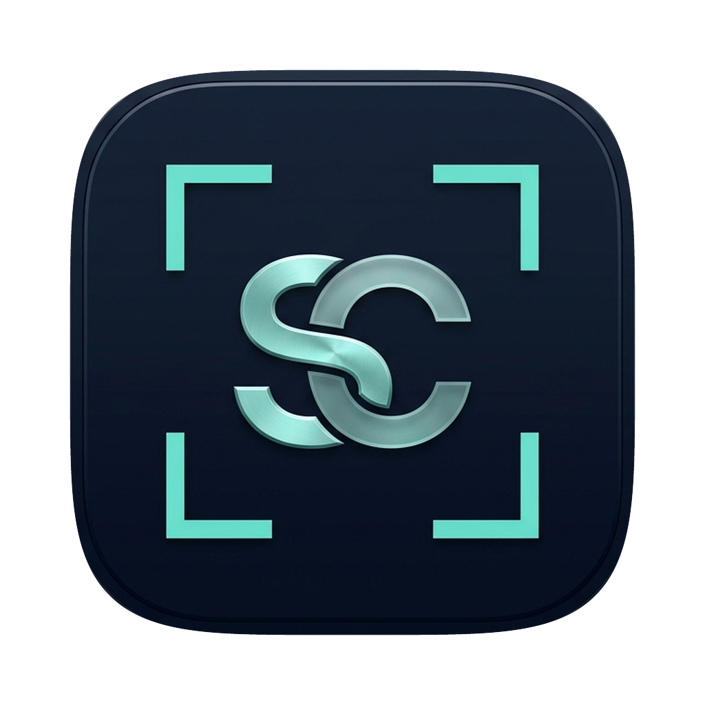
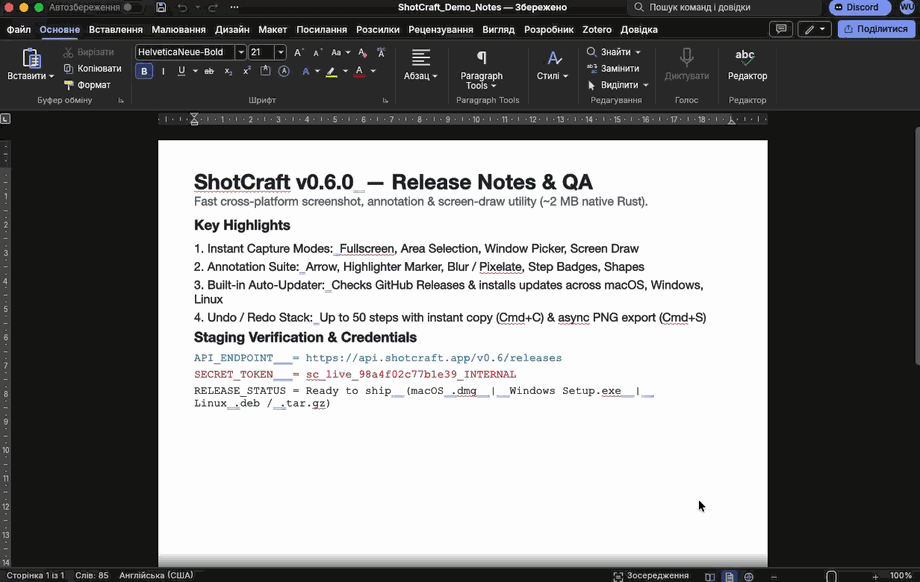
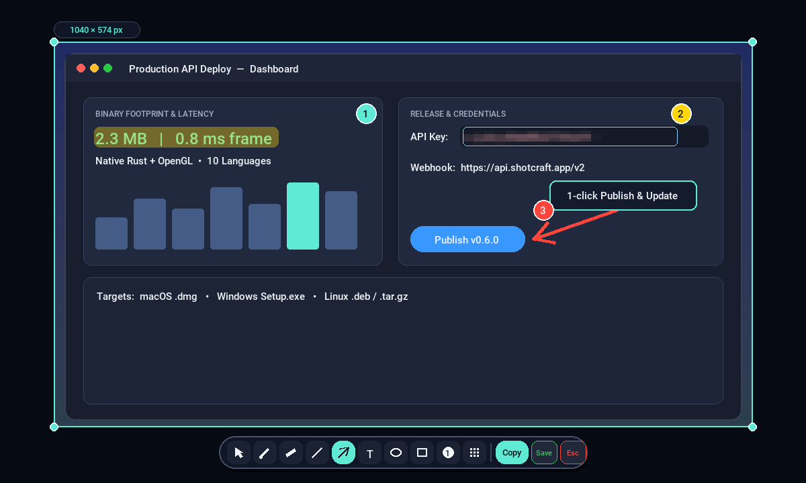
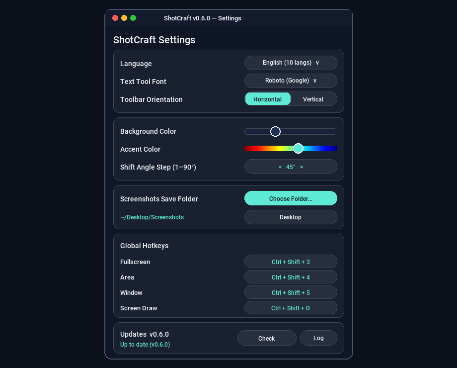

<div align="center">



# ShotCraft

**Ultra-fast, ~2 MB cross-platform screenshot & live screen-annotation app in Rust.**

[](https://github.com/Byakatris/ShotCraft/releases/latest)
[)](https://github.com/Byakatris/ShotCraft/actions/workflows/ci.yml)
[](LICENSE)

</div>

---

## Download `v0.6.0`

Pick your platform for a direct 1-click installer (or view [all releases](https://github.com/Byakatris/ShotCraft/releases/latest)):

| Platform | Direct Installer | Architecture |
| :--- | :--- | :--- |
| **macOS** | [**Download `ShotCraft-v0.6.dmg`**](https://github.com/Byakatris/ShotCraft/releases/download/v0.6.0/ShotCraft-v0.6.dmg) | Apple Silicon (`arm64`) |
| **Windows (x64)** | [**Download `ShotCraft-v0.6-Setup.exe`**](https://github.com/Byakatris/ShotCraft/releases/download/v0.6.0/ShotCraft-v0.6-Setup.exe) | Windows 10/11 (`x64`) |
| **Windows (ARM64)** | [**Download `ShotCraft-v0.6-arm64-Setup.exe`**](https://github.com/Byakatris/ShotCraft/releases/download/v0.6.0/ShotCraft-v0.6-arm64-Setup.exe) | Windows 11 (`arm64`) |
| **Linux (Debian / Ubuntu)** | [**Download `ShotCraft-v0.6-linux-amd64.deb`**](https://github.com/Byakatris/ShotCraft/releases/download/v0.6.0/ShotCraft-v0.6-linux-amd64.deb) | Ubuntu / Debian (`amd64`) |
| **Linux (Universal)** | [**Download `ShotCraft-v0.6-linux-x86_64.tar.gz`**](https://github.com/Byakatris/ShotCraft/releases/download/v0.6.0/ShotCraft-v0.6-linux-x86_64.tar.gz) | Any x86_64 distro |

<div align="center">



</div>

---

## Highlights

- **4 Capture Modes:** Instant Fullscreen, Multi-Monitor Area Selection, Window Picker, and transparent **Screen Draw** overlay over live apps or calls.
- **10 Annotation Tools:** Move/Resize, Pen, Highlighter Marker (uniform alpha, no seams), Line, Arrow (`Shift` angle snap), Text & Callout, Ellipse, Rectangle, crisp vector **Step** numbers, plus **Gaussian Blur & Pixelate**.
- **Built-in Auto-Updater:** Checks GitHub Releases automatically and downloads/applies new updates right from the tray menu or Settings (`Update now`).
- **50-Step Undo / Redo & Async PNG Save:** Zero-wait clipboard copy (`Cmd/Ctrl + C`) and non-blocking fast PNG export (`Cmd/Ctrl + S`).
- **True Multi-Monitor & Mixed-DPI Support:** Pixel-accurate HiDPI scaling across macOS Retina, Windows fractional DPI, and Linux X11 displays.
- **10 Languages & Custom Theme:** Full UI localization (`English`, `Українська`, `Español`, `Français`, `Deutsch`, `Polski`, `Italiano`, `Português`, `Türkçe`, `Nederlands`), Material 3 spring UI, horizontal/vertical toolbar, and custom hotkeys.

---

## Screenshots

| Live Selection & Annotation Overlay | Settings, Hotkeys & Built-in Auto-Updater |
| :---: | :---: |
|  |  |

---

<details>
<summary><b>Default Shortcuts & Tool Hotkeys</b></summary>

| Action | macOS | Windows / Linux |
| :--- | :--- | :--- |
| Instant Fullscreen | `Opt + Shift + 1` | `Alt + Shift + 1` |
| Capture Area | `Opt + Shift + 2` | `Alt + Shift + 2` |
| Capture Window | `Opt + Shift + 3` | `Alt + Shift + 3` |
| Screen Draw | `Opt + Shift + 4` | `Alt + Shift + 4` |
| Tool Selection (`1`–`0`) | `1..0` (`Cmd` fills shapes / pixelates blur) | `1..0` (`Ctrl` fills shapes / pixelates blur) |
| Undo / Redo | `Cmd + Z` / `Cmd + Shift + Z` | `Ctrl + Z` / `Ctrl + Shift + Z` |
| Copy / Save / Cancel | `Cmd + C` (`Enter`) / `Cmd + S` / `Esc` | `Ctrl + C` (`Enter`) / `Ctrl + S` / `Esc` |

</details>

<details>
<summary><b>Platform Install Notes (macOS, Windows, Linux)</b></summary>

- **macOS:** Builds are ad-hoc signed. On first launch, allow ShotCraft in *System Settings → Privacy & Security* (or run `xattr -cr /Applications/ShotCraft.app`) and grant **Screen Recording** access.
- **Windows:** NSIS user-level installer (`%LOCALAPPDATA%\ShotCraft`, no admin rights needed). Click *More info → Run anyway* if SmartScreen warns on an unsigned binary.
- **Linux:** X11 supports full global hotkeys and multi-monitor overlays. On Wayland sessions, tray-menu captures work while global hotkeys may require X11/XWayland depending on your compositor.
- **Diagnostics:** Open the rotating log folder (`shotcraft.log`) anytime via the **Log** button in *Settings*.

</details>

<details>
<summary><b>Build & Package from Source</b></summary>

```bash
# Run unit & golden WYSIWYG pixel tests
RUSTFLAGS="-D warnings" cargo test

# CLI checks
cargo run -- --version
cargo run -- --smoke-test

# Build & package per platform
./package_dmg.sh                    # macOS (.dmg)
./package_windows.sh                # Windows x64 NSIS (.exe) — native on Windows or cross-compiled via mingw
WIN_ARCH=arm64 ./package_windows.sh # Windows ARM64 NSIS (.exe) — native on Windows ARM64
./package_linux.sh                  # Linux (.deb & .tar.gz)
```

</details>

---

Licensed under the [MIT License](LICENSE). See [NOTICE](NOTICE) for third-party font attribution.
